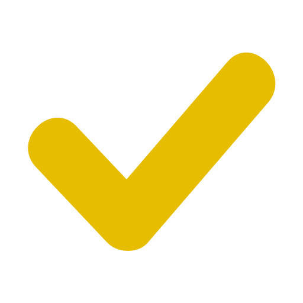

# Day Check
Simple app to track your progress on a task you want to achieve every day for a specific amount of days.  
See it at :  
https://daycheck.fr

Frontend is built with Vue 3 + Vite, server is a tiny Express app.  
In its current state, the server code only serves static files and manages the history mode of the vue router by redirecting all URLs to index.html.

## Environment setup
Install Node 22.12+ (24 LTS recommended) :
https://nodejs.org/en/download/


## Project setup
```
npm install
```

### Compiles and hot-reloads frontend AND server for development
```
npm run dev
```
Frontend dev server runs on http://localhost:5173

### Compiles and minifies frontend AND server for production
```
npm run build
```

### Run server
```
node server/bootstrap.js
```
Run it as a service with PM2 :
```
pm2 start bootstrap-pm2.json
```

## Run with Docker
A multi-stage `Dockerfile` builds the frontend and the server, then ships only the
production dependencies and the compiled output. The app is served on port `3003`.

Build and run with Docker :
```
docker build -t daycheck .
docker run -d -p 3003:3003 --name daycheck daycheck
```

Or with Docker Compose :
```
docker compose up -d --build
```

Then open http://localhost:3003
